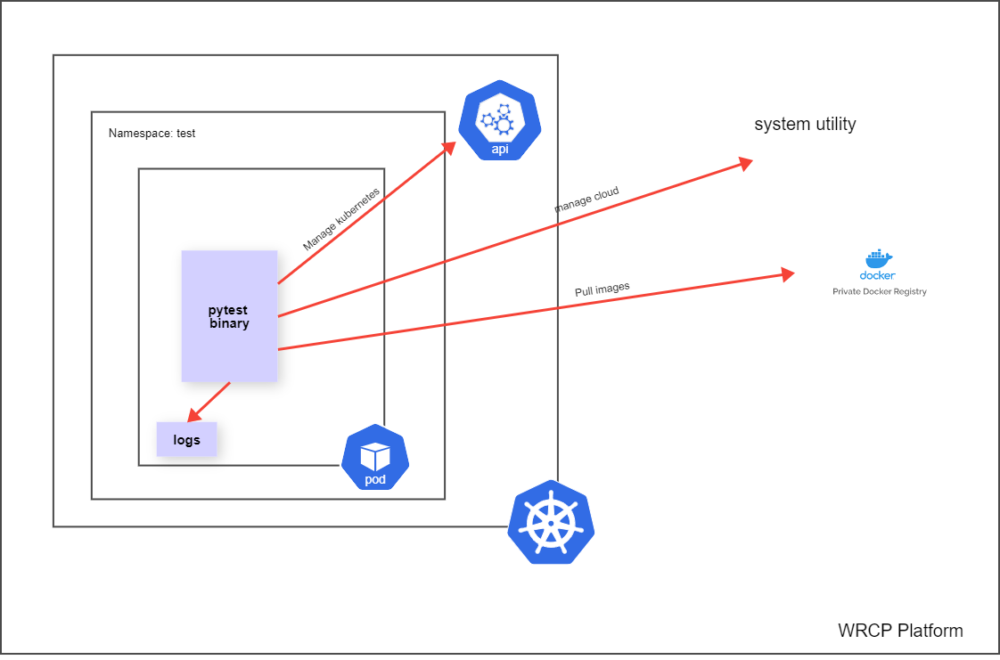

# Copyright Notice


Copyright © 2020‑2022 Wind River Systems, Inc.All rights reserved. No part of this publication may be reproduced or transmitted in any form or by any means without the prior written permission of Wind River Systems, Inc.


Wind River, Simics, Tornado, and VxWorks are registered trademarks of Wind River Systems, Inc. Helix, Pulsar, Rocket, Titanium Cloud, Titanium Control, Titanium Core, Titanium Edge, Titanium Edge SX, Titanium Server, and the Wind River logo are trademarks of Wind River Systems, Inc. Any third‑party trademarks referenced are the property of their respective owners. For further information regarding Wind River trademarks, please see:

[windriver](www.windriver.com/company/terms/trademark.html)

This product may include software licensed to Wind River by third parties. Relevant notices (if any) are provided for your product on the Wind River download and installation portal, Wind Share: windshare.windriver.com 

Wind River may refer to third‑party documentation by listing publications or providing links to third‑party websites for informational purposes. Wind River accepts no responsibility for the information provided in such third‑party documentation.


Corporate Headquarters
Wind River
500 Wind River Way
Alameda, CA 94501‑1153
U.S.A.
Toll free (U.S.A.): +1‑800‑545‑WIND
Telephone: +1‑510‑748‑4100
Facsimile: +1‑510‑749‑2010

For additional contact information, see the Wind River website:

[windriver](www.windriver.com)

For information on how to contact Customer Support, see:
[support](www.windriver.com/support)

# Automated test cases for the platform and distributed cloud using pytest

# Table of contents
1. [Introduction](#introduction)
    1. [Architecture](#architecture)
    2. [Scope of Change](#scope)
    3. [System Requirements](#requirements)
    4. [limitations](#limitations)
    5. [Pre-Deployment](#predeployment)
2. [Run Remotely](#run-remotely)
3. [Run from within WRCP](#run-localy)
4. [Configuration Options](#configuration)
5. [Delete Test Suite](#Delete)
6. [Source Code](#source-code)

# Introduction <a name="introduction"></a>
## Architecture <a name="architecture"></a>


## Scope of Change <a name="scope"></a>
This procedure installs the wrcp testsuite and does a platform sanity tests to verify the installation of the platforms

## System Requirements <a name="requirements"></a>
1. The System Controller and subclouds must be running Wind River Cloud Platform

2. Pull the below images from the Windriver harbor registry

| Image | Local registry path | Comments |
| :----: | :----: | :----: |
| harbor.ki.wrs.local/ps_emea/wrcptestsuite:22.27 | registry.local:9001/ps_emea/wrcptestsuite:22.27 | Only on the system where the test case is run |
| harbor.kista.wrs.local/ps_emea/node-hello:1.0 | registry.local:9001/ps_emea/node-hello:1.0 | All the clouds which has to be tested |
| harbor.kista.wrs.local/ps_emea/resource-consumer:1.9 | registry.local:9001/ps_emea/resource-consumer:1.9 | All the clouds which has to be tested |
| harbor.kista.wrs.local/ps_emea/resource-consumer:1.9 | registry.local:9001/ps_emea/resource-consumer:1.9 | All the clouds which has to be tested |
| docker pull harbor.kista.wrs.local/ps_emea/wind-test:22.06.0 |  registry.local:9001/ps_emea/wind-test:22.06.0 | All the clouds which has to be tested |
| harbor.kista.wrs.local/ps_emea/centos:22.06.0 | registry.local:9001/ps_emea/centos:22.06.0 | All the clouds which has to be tested  |

3. Kubernetes service is up and running

## LIMITATIONS <a name='limitations'></a>
1. All the subclouds should have same username and password 

## Pre-deployment<a name='predeployment'></a>
The following actions must be performed before Deployment

1. Pull the required images from the harbor (If the system has internet connectivity)
```bash
docker login harbor.kista.wrs.local
docker pull harbor.kista.wrs.local/ps_emea/wrcptestsuite:22.27
docker pull harbor.kista.wrs.local/ps_emea/wind-test:22.06.0
docker pull harbor.kista.wrs.local/ps_emea/node-hello:1.0
docker pull harbor.kista.wrs.local/ps_emea/resource-consumer:1.9
docker pull harbor.kista.wrs.local/ps_emea/centos:22.06.0
```
2. If the system doesnot have internet connectivity, copy the wrcptestsuite-images.tar.gz tar file to the system from where the test is performed and execute the below commands.
```bash
docker load -i wrcptestsuite-images.tar.gz
```
3. Tag the images
```bash
docker image tag harbor.kista.wrs.local/ps_emea/wrcptestsuite:22.25 registry.local:9001/ps_emea/wrcptestsuite:22.27
docker image tag harbor.kista.wrs.local/ps_emea/wind-test:22.06.0 registry.local:9001/wind-test:22.06.0
docker image tag harbor.kista.wrs.local/ps_emea/node-hello:1.0 registry.local:9001/ps_emea/node-hello:1.0
docker image tag harbor.kista.wrs.local/ps_emea/resource-consumer:1.9 registry.local:9001/ps_emea/resource-consumer:1.9
docker image tag harbor.kista.wrs.local/ps_emea/centos:22.06.0 registry.local:9001/ps_emea/centos:22.06.0
```

3. Push the images to the local registry of the WRCP
```bash
docker login registry.local:9001
docker push registry.local:9001/ps_emea/wrcptestsuite:22.27
docker push registry.local:9001/ps_emea/node-hello:1.0
docker push registry.local:9001/ps_emea/resource-consumer:1.9
docker push registry.local:9001/ps_emea/wind-test:22.06.0
docker push registry.local:9001/ps_emea/centos:22.06.0
```
**NOTE: use the admin credentials of the registry to push the image**

4. Create the secrets for pulling the images from testsuite in the local namespace and test namespace
```bash
kubectl create secret docker-registry --docker-server=registry.local:9001 --docker-username=admin --docker-password=<registry-admin-password> registry-creds
kubectl create namespace test
kubectl create secret docker-registry --docker-server=registry.local:9001 --docker-username=admin --docker-password=<registry-admin-password> registry-creds -n test
kubectl create ns rc
kubectl create secret docker-registry --docker-server=registry.local:9001 --docker-username=admin --docker-password=<registry-admin-password> registry-creds -n rc
```
**NOTE: replace <registry-admin-password> with the registry admin password**

**NOTE: The wrcptestsuite should be deployed on the active controller as it will bring down the other nodes except the active controller as part of tests**

## Run the test suite remotely <a name='run-remotely'></a>
1. Running the test suite

```bash
mkdir test-config
cat <<EOF> test-config/lab.json
{
  "cloud_1": {
  "short_name": "cloud1",
  "name": "cloud1.com",
  "floating ip": "<floating-ip>",
  "controller-0 ip": "<controller-0>",
  "controller-1 ip": "<controller-1>"
 },
 "cloud_2": {
  "short_name": "cloud2",
  "name": "cloud2.com",
  "floating ip": "<floating-ip>",
  "controller-0 ip": "<controller-0>",
  "controller-1 ip": "<controller-1>"
 }
}
EOF

cat <<EOF > test-config/stx-test_template.conf
[auth]
oam_floating_ip =
controller0_oam_ip =
controller1_oam_ip =
linux_username = sysadmin
linux_user_password = <linux_user_password>
# Platform keystone admin user and project info
platform_admin_username = admin
platform_admin_project_name = admin
platform_admin_password = <platform_admin_password>
platform_admin_domain_name = Default

[natbox]
natbox_host = localhost
natbox_user = tester
natbox_password = tester
EOF

sudo docker run -v $(pwd)/test-config:/root/test-config --name wrcptestsuite --env SOURCE_OPENRC=True --env IS_SIMPLEX=False --env IS_DC=False --env INCLUDE=cloud_1 -d registry.local:9001/ps_emea/wrcptestsuite:22.27 bash /usr/wrcptestsuite/bin/entrypoint.sh
```
2. Checking the logs
```bash
sudo docker logs wrcptestsuite
```

3. Login to the container
```bash
sudo docker exec -it wrcptestsuite bash
```

## Running the test inside the wrcp cluster <a name='run-localy'></a>

On the active controller create a file test.yml with below content

```bash
---
apiVersion: v1
kind: ConfigMap
metadata:
  name: test-config
  namespace: test
data:
 lab.json: |
   {
    "cloud_1": {
    "short_name": "cloud1",
    "name": "cloud1.com",
    "floating ip": "<floating-ip>",
    "controller-0 ip": "<controller-0>",
    "controller-1 ip": "<controller-1>"
    },
    "cloud_2": {
    "short_name": "cloud2",
    "name": "cloud2.com",
    "floating ip": "<floating-ip>",
    "controller-0 ip": "<controller-0>",
    "controller-1 ip": "<controller-1>"
    }
   }

 stx-test_template.conf: |
   [auth]
   oam_floating_ip =
   controller0_oam_ip =
   controller1_oam_ip =
   linux_username = sysadmin
   linux_user_password = <linux_user_password>
   # Platform keystone admin user and project info
   platform_admin_username = admin
   platform_admin_project_name = admin
   platform_admin_password = <platform_admin_password>
   platform_admin_domain_name = Default

   [natbox]
   natbox_host = localhost
   natbox_user = tester
   natbox_password = tester
---
apiVersion: v1
kind: Pod
metadata:
  name: wrcptestsuite
  namespace: test
spec:
  nodeName: controller-1
  imagePullSecrets:
   - name: registry-creds
  containers:
   - name: wrcptestsuite
     image: registry.local:9001/ps_emea/wrcptestsuite:22.27
     volumeMounts:
       - name: test-config
         mountPath: /root/test-config/
     env:
       - name: SOURCE_OPENRC
         value: "True"
       - name: IS_SIMPLEX
         value: "False"
       - name: IS_DC
         value: "False"
       - name: INCLUDE
         value: "cloud_1 cloud_2"
     imagePullPolicy: Always
     command: ["bash", "/usr/wrcptestsuite/bin/entrypoint.sh"]
  volumes:
     - name: test-config
       configMap:
         name: test-config
```
**NOTE: List all the clouds and subclouds that are to be tested in the lab.json configmap of the Manifest**


## Configuration Options <a name='configuration'></a>

| Configuration option | Type| Default | Description |
|    :----:           | :----: | :----: | :----: |
|<floating_ip> | String | None | Floating IP of  WRCP |
|<controller-0_ip> | String | None | controller-0 ip of WRCP |
|<controller-1_ip> | String | None | controller-1 ip of WRCP |
|SOURCE_OPENRC | Boolean  | "True" | Weather to use the /etc/platform/openrc file for all the test cases, if this is False then the defaults that are hardcoded in the scripts are used |
|IS_SIMPLEX | boolean | "False" |Type of the system, True if it is Simplex and False if it is not.This setting will automatically exclude all the tests that are not for a specified platform |
|IS_DC | boolean | "False" |Type of the system, True if it is Distributed cloud else False |
|INCLUDE | string | NA | Clouds that are to be included for testing which is part of lab.json |
|linux_username | string | sysadmin | sysadmin user to login to the controllers |
|linux_user_password | string | <sysadmin_password> | sysadmin password for the controller nodes |
|platform_admin_username |string |admin | Openstack admin user |
|platform_admin_project_name | string | admin | Openstack admin project | 
|<platform_admin_password> | string | None |Openstack admin password|
|platform_admin_domain_name | string |Default|

## Apply WRCP testsuite

7. Deploy the testsuite on the active controller
```bash
kubectl apply -f test.yml
kubectl get pods wrcptestsuite -n test
```
**NOTE: The container should be in the Ruinning state**

8. Check the test case execution status
```bash
kubectl logs wrcptestsuite -n test
```

## Re-running the test suite
1. Login to the wrcp test suite
```bash
kubectl exec -it  wrcptestsuite -n test  -- bash
```

2. Run the testsuite Manually
```bash
bash /usr/wrcptestsuite/bin/entrypoint.sh
```

3. Checking the logs
```bash
tailf /root/AUTOMATION_LOGS/<cloud-name>/<latest-timestamp>/TIS_AUTOMATION.log
```

## Checking the test report after the test run
```bash
kubectl exec -it  wrcptestsuite -n test -- bash
cd /usr/wrcptestsuite/automated-pytest-suite/
python3 generateReport.py
```

## Executing selected test cases

To run only the required test cases do as below.

Example: Running only the lock_unlock of the nodes test case
```bash
kubectl exec -it  wrcptestsuite -n test  -- bash
cd /usr/wrcptestsuite/automated-pytest-suite/
pytest  -m platform_sanity --lab=cloud_2 --testcase-config=/root/test-config/stx-test_template.conf testcases/functional/mtc/test_lock_unlock_host.py::test_lock_unlock_host
```
## Troubleshooting the testsuite.
```bash
kubectl describe pod wrcptestsuite -n test
```
## Deleting the testsuite <a name='Delete'></a>
```bash
kubectl delete  -f test.yml
kubectl delete ns test
```
## SOURCE CODE STRUCTURE <a name='source-code'></a>

All the source code for the automation test suite is present in /usr/wrcptestsuite/automated-pytestsuite/ folder inside the pod **wrcptestsuite** under **test** namespace.

Below directories are the subdirectories which contains the libraries for the  automation suite.

**testcases**

This folder contains the test cases that must be included or skipped from the execution. These are bare minimum python scripts which does the analysis if the test case has passed or failed using the assert python instruction. It uses the libraries in the keywords folder for the actual implementation.

**utils**

This folder contains all the utilities required to run the test cases.

For example, it would contain the pod manifests that are brought up to test some pod-to-pod communication features. These files are then copied to the target machine and run.

**keywords**

This folder contains the actual implementation/logic of the test cases. Example, this folder contains python scripts that will login to the active controller and get some information. The information from this function would be returned to the testcase where the pass or fail criteria is checked.

**consts**

This folder contains all the test related configurations, it controls how the test is executed. Example, use the /etc/platform/openrc file to source the credentials on each node.

**NOTE: When using the container image for automated testsuite all the variables defined in consts are retrieved from the environment variables**


## Overview of the test execution
When the test suite is run, it reads all the information of the nodes from the configuration files and creates a sshClient object for connecting to the active controller, using the floating ip of the node. It then logs in the platform under test using the credentials using SSH. It then executes all the test cases that are part of the test suite using either the system commands, kubectl cli or the raw bash terminal. It also copies all the manifests and other files that are required to execute the test case to the system under test. It then gathers the test results to the logs and gives a detailed output of the test summary.

## Extending the test suite:

Extending the test suite is very simple, if one is familiar with the python programming language.

All the test cases are inside the testcases directory. Create a directory name with the group name that the test case belongs to like networking, dpdk, sriov etc.

Inside the directory create a file with the name of the test case and create a class and also  write the test cases inside the file. Below is an example of the customized test case.

```bash

$ cd testcases/
$ mkdir custom_test_cases/
$ cd custom_test_cases/
$ cat test_custom_test.py
#
# Copyright (c) 2020 Wind River Systems, Inc.
#
# SPDX-License-Identifier: Apache-2.0
from pytest import mark, fixture

from consts.proj_vars import ProjVar
from keywords import system_helper, kube_helper, common


# markers are the important aspects of the test suite, it gives feasibility to execute group of testcases based on a label. eg. platform_sanity will group all the testcases with the label into one.
@mark.platform_sanity
@mark.dc_subcloud
#Class name should be same as the name of the file without special characters and every first letter of the word in Caps. The test suite will automatically execute all fuctions part of the class.

class TestCustomTest:
    def test_custom_test(self):
        """
        Verify Ping test between pods
        Args:
            deploy_test_pods(fixture): returns server_ips, client_pods, deployment_name, service_name
        Setup:
            - Label the nodes and add node selector to the deployment files
                if not simplex system
            - Copy the deployment files from localhost to active controller
            - Deploy server pod
            - Deploy client pods
        Steps:
            - Ping the server pod ip from the client pod
        Teardown:
            - Delete the service
            - Delete the server pod deployment
            - Delete the client pods
            - Remove the labels on the nodes if not simplex
        print("This is a custom function")
        """
```
